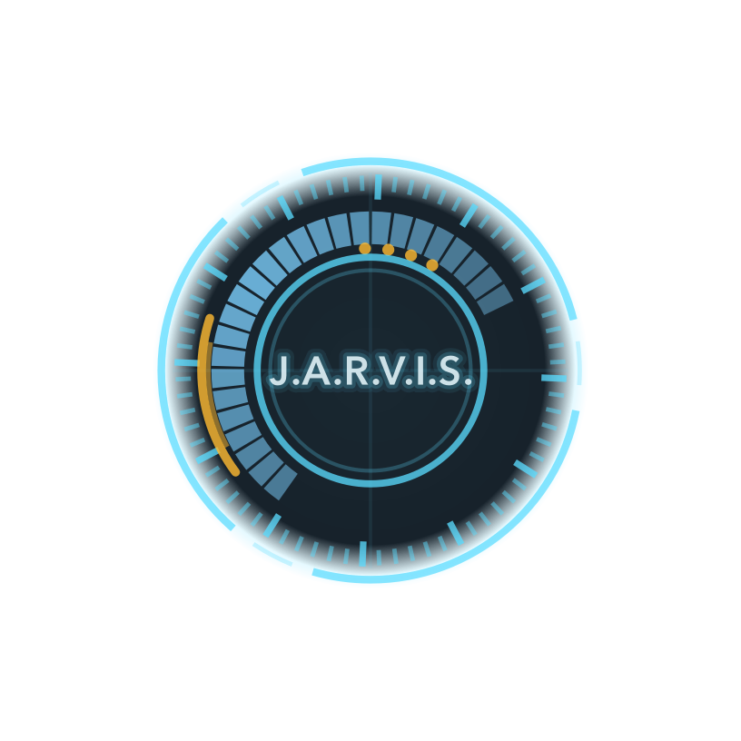
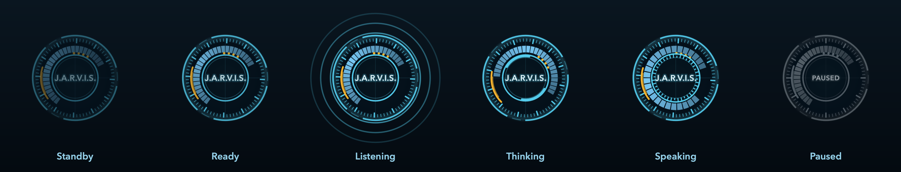

<p align="center">
  
</p>

<h1 align="center">J.A.R.V.I.S</h1>

<p align="center">
  A free, fully local desktop tutor for macOS on Apple Silicon.<br>
  It sees your screens, listens for <b>"Hey Jarvis"</b>, and answers in a JARVIS-style British voice,<br>
  usually about 1.5 s after you finish your question.
</p>

---

## What it does

- **Sees what you see.** Reads the display the orb is sitting on, in the background, with Apple's on-device OCR.
  Drag the orb to your external monitor and JARVIS reads that screen; drag it back and it reads the laptop.
  Multi-pane windows (sidebar, editor, chat) are read pane by pane.
- **Knows what you point at.** Highlight some text and ask "explain this", or point the mouse at something and ask
  "what does this mean?". JARVIS uses the selection, or the text under the pointer.
- **Talks with you.** Wake word, speech-to-text, a local LLM and a British voice, all on your Mac.
  No cloud, no API keys, no cost.
- **Teaches.** Four modes: Explain, Teach me (step by step), Debug (errors and code on screen) and Quiz me.
  It remembers which topics you have been studying.
- **Stays out of the way.** A floating orb shows what it is doing. After 5 minutes of quiet it unloads its models
  and drops to about 300 MB of memory.

## Requirements

- A Mac with Apple Silicon (M1 or newer) and 16 GB of memory recommended
- macOS 14 or newer
- [Ollama](https://ollama.com/download) installed
- About 10 GB of free disk space for the models

## Install

```sh
git clone https://github.com/sridjnath09/J.A.R.V.I.S.git
cd J.A.R.V.I.S
./setup.sh
```

`setup.sh` installs [uv](https://docs.astral.sh/uv/) if needed, creates a Python 3.12 environment in `.venv`,
installs the dependencies, pulls the two Ollama models, and downloads the voice, speech-to-text and wake-word
models. It is safe to run again.

## How to start JARVIS

### First time only

1. **Open Terminal.app** (Applications > Utilities > Terminal). Use Terminal rather than an editor's built-in
   terminal: macOS grants screen and microphone access per app, and Terminal is the simplest to set up.
2. From the project folder, start it:

   ```sh
   ./run.sh
   ```

3. **Grant permissions** when macOS asks, then restart JARVIS (`Ctrl+C`, then `./run.sh` again):

   | Permission | Where to grant it | Needed for |
   | --- | --- | --- |
   | Microphone | pop-up on first run | wake word and your questions |
   | Screen & System Audio Recording | System Settings > Privacy & Security, turn on **Terminal** | reading your screens |
   | Accessibility (recommended) | System Settings > Privacy & Security, turn on **Terminal** | explaining highlighted text, and the ⌥J show/hide hotkey |

### Every day after that

```sh
cd path/to/J.A.R.V.I.S
./run.sh
```

You will see `J.A.R.V.I.S is running.` and the orb appears at the bottom right of your screen.
`run.sh` starts Ollama for you if it is not already running.

**Tip: start it with one word.** Run this once from the project folder, then open a new Terminal window and
type `jarvis` from anywhere:

```sh
echo "alias jarvis='$(pwd)/run.sh'" >> ~/.zshrc
```

### Stopping

Right-click the orb and choose **Quit J.A.R.V.I.S**, or press `Ctrl+C` in its Terminal window.

## Using it

<p align="center">
  
</p>

| Orb | Meaning |
| --- | --- |
| **Standby** | Dim and breathing. Models are unloaded; only the wake word and screen reader are running. |
| **Ready** | Awake and quick to answer. |
| **Listening** | Ripples: it is recording your question. |
| **Thinking** | Rings spin: transcribing and generating. |
| **Speaking** | The blue band and inner bars move with its voice. |
| **Paused** | Grey: not watching or listening. |

**Talking to it**

- Say **"Hey Jarvis"** or **click the orb**, then ask. The first question after standby takes about 4 to 6 s
  while models load; after that answers start in about 1.5 s.
- For **45 s after each answer** you can ask a follow-up without the wake word.
- **Click and hold** the orb for push-to-talk.
- **Interrupt it any time:** just start talking (with headphones), say **"Hey Jarvis"** or **"stop"**, press **Esc**,
  or click the orb. Long answers are cut after a few sentences; the rest is in the transcript.
- **Double-click** the orb for the transcript (answers, code blocks, per-question latency).
- **Right-click** for the menu: stand by, pause, mode, voice effects, transcript, quit.
- **Drag** the orb to the screen you want JARVIS to read; it snaps to screen edges and remembers its spot.
  Hover over it to see which display it is reading. **⌥J** hides or shows it.
- **Highlight text** in any app and ask "explain the highlighted text" or "what does this mean?". Selections are read
  through macOS Accessibility; for apps that hide them, JARVIS presses ⌘C and then restores your clipboard.
- **Point the mouse** at a word, line or error and ask "what is this?". If you click the orb to talk, JARVIS uses
  where the pointer was just before.
- Questions about charts, images or diagrams ("what does this chart show?") use the vision model on the area around
  the pointer, which is slower (about 5 to 10 s).

**Voice commands:** "stop", "stand by", "stay awake", "pause", "teach me mode", "quiz me", "debug mode", "explain mode".

**Privacy:** screen captures stay in memory and are never saved. Apps on the blocklist in `config.yaml`
(password managers, trading apps, Wallet, ...) are blacked out before reading, on any display. JARVIS's own
orb and transcript are invisible to its screen reader.

## Configuration

Everything lives in [`config.yaml`](config.yaml):

| Setting | What it changes |
| --- | --- |
| `tts.voice` | `bm_george` (default), `bm_lewis`, `bm_daniel`, `bm_fable` |
| `tts.fx_preset` | JARVIS effects: `off`, `subtle`, `classic`, `full-lab` (also in the orb menu) |
| `listen.end_silence_ms` | how long a pause ends your question (lower is faster but may cut you off) |
| `listen.barge_in` | `true` (default) lets you talk over JARVIS to interrupt it; set `false` on speakers, where it would hear itself |
| `tts.max_spoken_chars` | how much of an answer is spoken (default 450 characters); the rest is shown in the transcript |
| `lifecycle.*` | follow-up window (45 s) and idle time before standby (5 min) |
| `screen.read` | `orb` (default): read only the display the orb is on; `all`: read every display |
| `screen.blocklist` | apps JARVIS never reads |
| `ui.orb_size` | orb diameter in points (default 110) |

## Troubleshooting

| Symptom | Fix |
| --- | --- |
| It never hears "Hey Jarvis" | Microphone permission for Terminal; check the right input device in System Settings > Sound. |
| It describes the wrong screen or nothing | Screen Recording permission for Terminal, then restart JARVIS. |
| Answers are slow | Check memory: JARVIS needs about 6 GB free. If Activity Monitor shows heavy swap, close other large apps. The transcript (double-click the orb) shows which stage is slow. |
| It ignores highlighted text | Accessibility permission for Terminal, then restart. |
| Hotkey ⌥J does nothing | Accessibility permission for Terminal, then restart. |

Check the whole pipeline without a microphone (prints the latency of each stage):

```sh
.venv/bin/python -m jarvis.selftest          # writes data/selftest.wav
.venv/bin/python -m jarvis.selftest --play   # and plays the answer
```

Measured on an M1 with 16 GB: speech-to-text 0.19 s, first LLM token 0.58 s, first audio 1.0 s after you stop
talking, plus about 0.65 s to detect that you stopped.

## Models (all local and free)

| Part | Model |
| --- | --- |
| Answers | `qwen3:4b-instruct-2507-q4_K_M` (Ollama) |
| Visual questions | `qwen2.5vl:7b` (Ollama) |
| Speech-to-text | `mlx-community/parakeet-tdt-0.6b-v2` (MLX, Apple GPU) |
| Voice | Kokoro-82M ONNX (`models/`) + pedalboard effects |
| Wake word and voice detection | openWakeWord "hey jarvis", Silero VAD |
| Screen reading | Apple Vision OCR |

## Project layout

```
jarvis/
  main.py            orchestrator: lifecycle, audio routing, question pipeline
  perception/        screen capture, change detection, OCR, screen state
  voice/             mic, wake word + VAD, speech-to-text, Kokoro TTS, effects, player
  brain/             persona and modes, Ollama client with KV-cache prewarm, router, sentence splitter
  memory/            SQLite history and learning profile
  ui/                floating orb (HUD), transcript panel, menu, hotkey, macOS window tweaks
config.yaml          all settings
setup.sh             one-time install
run.sh               start script
docs/                README images
```
